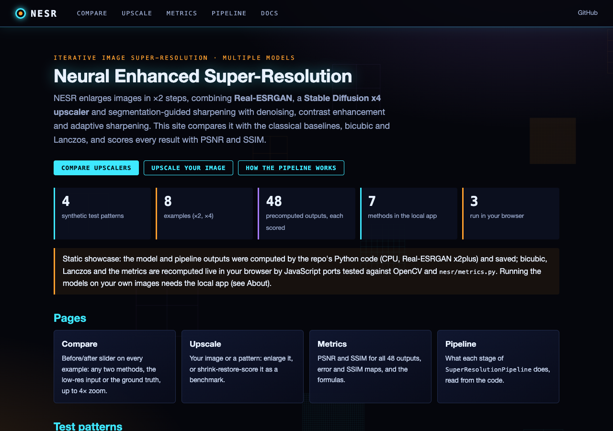
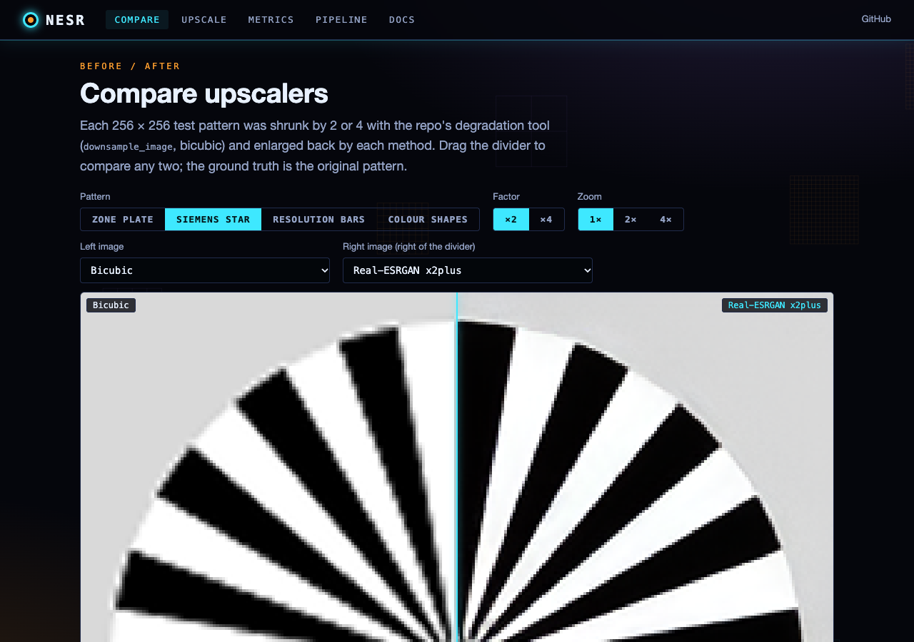
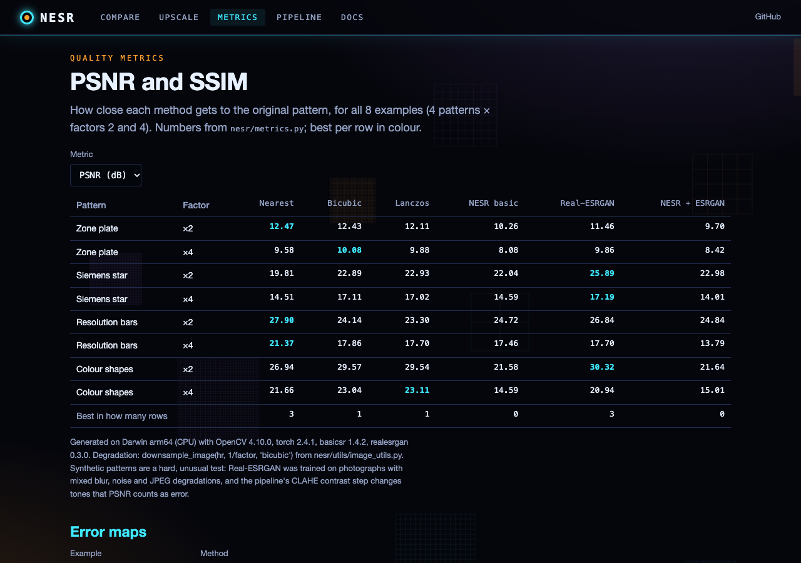

# Neural Enhanced Super-Resolution (NESR)

A Python project for iterative image super-resolution using multiple AI models.

## Overview

NESR combines state-of-the-art super-resolution techniques to enhance image resolution in an iterative manner. The pipeline leverages multiple models:

- **Real-ESRGAN**: Powerful GAN-based upscaler for realistic texture generation
- **Stable Diffusion Upscaler**: Text-guided diffusion model for high-quality upscaling
- **Segmentation-based enhancement**: Targeted improvements for specific image regions
- **Adaptive post-processing**: Detail-aware sharpening and contrast enhancement

Each enhancement iteration can increase resolution while preserving and enhancing details using a multi-model ensemble approach.

## Features

- Multi-stage iterative enhancement
- Model ensemble for better results than any single approach
- Content-aware processing through segmentation
- Detail preservation techniques
- Guided upscaling using text prompts
- Configurable pipeline with sensible defaults

## Requirements

```
torch>=1.12.0
diffusers>=0.14.0
transformers>=4.25.0
opencv-python>=4.6.0
Pillow>=9.3.0
numpy>=1.23.0
tqdm>=4.64.0
realesrgan>=0.3.0
basicsr>=1.4.2
```

You'll also need to download model weights:
- Real-ESRGAN weights: [RealESRGAN_x2plus.pth](https://github.com/xinntao/Real-ESRGAN/releases)
- Stable Diffusion upscaler is downloaded automatically via Hugging Face

## Installation

1. Clone this repository
2. Create a virtual environment: `python -m venv venv`
3. Activate the environment:
   - Windows: `venv\Scripts\activate`
   - Linux/Mac: `source venv/bin/activate`
4. Install dependencies: `pip install -r requirements.txt`
5. Create a `weights` directory and download the model weights

## Usage

### Basic usage

```bash
python main.py --cli --input path/to/your/image.jpg
```

Without `--cli` and `--input`, `main.py` opens the desktop GUI (PyQt5).

### Advanced options

```bash
python main.py --cli --input input.jpg --output results/enhanced.png --iterations 3 --upscale_factor 2.0 --device cpu --prompt "a highly detailed photograph"
```

Parameters (from `main.py`):
- `--cli`: Run in command line mode (`--gui` opens the GUI)
- `--input`, `-i`: Path to input image
- `--output`, `-o`: Output image path (default: `outputs/<name>_enhanced_x<scale><ext>`)
- `--config`, `-c`: JSON file with pipeline settings (any key of the `SuperResolutionPipeline` config, e.g.
  `{"use_diffusion": false, "intermediate_saves": true}`)
- `--iterations`, `-n`: Number of enhancement iterations (default: 3)
- `--upscale_factor`, `-u`: Base upscale factor per iteration (default: 2.0)
- `--device`, `-d`: Device to run on ("cuda" or "cpu", default: "cuda"; falls back to MPS or CPU when CUDA is missing)
- `--prompt`, `-p`: Text prompt for diffusion guidance
- `--download_models`: Download the model weights and exit

### Python API

```python
from nesr import SuperResolutionPipeline

# Configure the pipeline
config = {
    "iterations": 3,
    "upscale_factor": 2.0,
    "use_diffusion": True,
    "output_dir": "results",
}

# Initialize the pipeline
pipeline = SuperResolutionPipeline(device="cuda", config=config)

# Enhance an image
enhanced_image_path = pipeline.enhance_image(
    "input.jpg", 
    prompt="a high resolution detailed photograph"
)

print(f"Enhanced image saved to: {enhanced_image_path}")
```

## How It Works

1. **Preprocessing**: Reduce noise and enhance contrast
2. **Segmentation**: Identify image regions for targeted enhancement
3. **Multi-model upscaling**: Apply different SR models in parallel
4. **Ensemble**: Combine results from different models
5. **Post-processing**: Apply adaptive sharpening to enhance details
6. **Iteration**: Repeat the process for progressive enhancement

## Results

NESR typically achieves higher quality results than single-model approaches, with particularly noticeable improvements in:
- Texture detail
- Edge sharpness
- Natural-looking results
- Artifact reduction

## Web interface

A browser front end to the same code, plus a static showcase site (GitHub Pages:
https://gddickinson.github.io/neural_enhanced_super_resolution/).



- **Compare**: before/after slider on synthetic test patterns (zone plate, Siemens star, resolution bars, colour shapes;
  `nesr/test_patterns.py`) shrunk by 2 or 4 and restored by nearest, bicubic, Lanczos-4, the NESR pipeline without neural
  models, Real-ESRGAN x2plus alone, and the NESR pipeline with Real-ESRGAN.
- **Upscale**: your own image or a pattern, in "upscale" mode or "benchmark" mode (shrink, restore, score).
- **Metrics**: PSNR and SSIM (`nesr/metrics.py`) of every precomputed output, error and SSIM maps.
- **Pipeline**: what each stage of `SuperResolutionPipeline` does.




### Run the web app

```bash
pip install -r requirements-web.txt   # classical methods, pipeline without neural models, metrics
pip install -r requirements.txt       # optional: Real-ESRGAN and the diffusion upscaler
python run_web.py                     # http://127.0.0.1:8168 (local only)
```

In the local app every method runs in Python on your computer (models only if installed). On the static site the model
outputs are precomputed (`python scripts/make_examples.py`, CPU), while nearest, bicubic and Lanczos (`resample.js`, an exact
port of `cv2.resize`) and PSNR/SSIM (`metrics.js`) run in the browser; node tests check both against Python
(`tests/fixtures/js_cases.json`, from `scripts/make_js_fixtures.py`). Build the site with `python scripts/build_static.py`.

Tests: `python -m pytest -q tests` (the real Real-ESRGAN test runs only when torch, basicsr and realesrgan are installed).

## Limitations

- High GPU memory requirements when using all models
- Processing time increases with iterations and image size
- May produce artifacts with very low-quality input images

## License

MIT


---
*Built with AI assistance from [Claude (Anthropic)](https://claude.com/).*
